<p align="center">
  
</p>

<h1 align="center">Trainz Studio</h1>

<p align="center">
  <strong>MSTN Production</strong> · since 2024<br/>
  A dark workbench for Trainz content — meshes, sounds, enginespecs, textures, and packages.
</p>

<p align="center">
  <a href="https://github.com/naseno15/mstn-trainz-studio/releases/latest"></a>
  <a href="https://github.com/naseno15/mstn-trainz-studio/releases/latest"></a>
  
  
</p>

<p align="center">
  <a href="#install">Install</a> ·
  <a href="#open--first-run">Open</a> ·
  <a href="#studios--what-works-now">Studios</a> ·
  <a href="#ภาษาไทย">ภาษาไทย</a> ·
  <a href="https://github.com/naseno15/mstn-trainz-studio/releases/latest">Download</a>
</p>

---

## Install

**Recommended — release zip (no Qt DLLs)**

1. Open the [latest release](https://github.com/naseno15/mstn-trainz-studio/releases/latest).
2. Download `TrainzStudio-*-win64.zip`.
3. Unzip anywhere (Desktop, `Tools\`, portable USB…).
4. Run `trainz_studio_cpp.exe` inside the folder.

That build is a **single static exe**. You do not need a Qt install to run it.

| | |
|---|---|
| Current | **v4.4.3** |
| Asset | `TrainzStudio-4.4.3-win64.zip` |
| OS | Windows 10 / 11 x64 |

**In-app update:** Help → Check for updates. When a newer tag with a `*win64.zip` exists, a toast offers **Install update** (downloads, replaces the folder, relaunches).

---

## Open · first run

1. Double-click `trainz_studio_cpp.exe` (GUI app — no console window).
2. A short boot card shows progress, then **Home**.
3. Click a studio card, or use the title menus / Tools.

| Tip | |
|---|---|
| Theme | Theme menu → Light / Dark (default matches the graphite + orange UI) |
| Language | Lang → English · ไทย · 日本語 · Indonesia |
| Crash recover | If the last run died, a sheet shows the end of `%LOCALAPPDATA%\TrainzStudio\trainz_studio.log` |
| Log | `%LOCALAPPDATA%\TrainzStudio\trainz_studio.log` |

Home, Mesh Studio, Sounds Studio, Engine Tuner, Assets Tools, Texture & Mesh Lods, and TrainzUtil share **one window**.

---

## Terminal

Same exe. No command opens the window. A command runs and exits:

```
trainz_studio_cpp.exe help
trainz_studio_cpp.exe mesh body.trainzmesh
trainz_studio_cpp.exe cdp pack.cdp
```

`help` · `version` · `kuid` · `mesh` · `cdp` · `tzarc` · `chump` · `zip` · `texture` · `wav` · `engine` · `lm` · `kin`

`mesh` reads `.trainzmesh`, `.im`, and `.fbx`. `cdp` lists assets, or prints one config when you pass a kuid. `tzarc` lists the archive, or prints a text member.

---

## Studios — what works now

Accent colour in the app: **`#ff5a1f`**. Panels sit on graphite (`#12161c` / `#1a1e26`).

### Mesh Studio · Mesh · FBX · lamps

Open / drop `.trainzmesh`, `.im`, `.fbx`.

| Area | What you can do |
|---|---|
| Viewport | Lit · Albedo · Normal · Rough · Metal · AO; Tab pie → Wireframe / Solid / Material / Render |
| Lighting | Softbox fill, sun / moon, array lamps, HDRI environments, ground plane, face orientation |
| Materials | Name, Type, Albedo / Normal / Parameters / Env maps, Material Color, Emissive, Specular, Specular Power |
| Live colour | Material Color shows in Material / Lit / Albedo (no map → flat colour; with map → texture × colour). Solid / Wireframe stay clay |
| Textures | Browse prefers `.texture.txt` / `.texture`; live preview reloads maps onto matching parts |
| Attachments | `a.*` triads, Attachs Editor location / rotation, Move tool drag, Save writes pose |
| Animation | Folder `.kin` clips bound per mesh; Play / Frame; attachments follow the posed mesh |
| Scene | Multi-file drop, per-file show / atts, Save / Save As for every dirty `.trainzmesh` (+ `.meta` two-sided) |
| Undo | Ctrl+Z / Ctrl+Shift+Z across attachments and material blocks |

### Sounds Studio · Loop · waveform · export

| Area | What you can do |
|---|---|
| Clips | Drop / open WAV; waveform scrub; gain; loop on/off |
| A → B | Set A (transition) + B (steady); play crossfade into the loop |
| Fix | Build seamless loop or transition as a **new** clip (never silent-overwrite the open file) |
| Export | **Save As** to a path you choose |

### Engine Tuner · Curves · throttle · sim

| Area | What you can do |
|---|---|
| Source | Open an enginespec / `config.txt` the tuner supports (also from TrainzUtil → Tuner) |
| Edit | Parameter pages, curve / throttle style tuning, simulation view |
| Save | Commit back toward the asset / CDP flow when opened from TrainzUtil |

### Assets Tools · CDP · config · KUID

| Tab | What you can do |
|---|---|
| Packages | Queue CDP / tzarc / zip / folder; Finder + breadcrumb; Viewer / Editor with line numbers; Ctrl+S |
| Config | Edit `config.txt` / `config.chump` as sunk fields (identity, containers, KUID pickers) |
| KUID | Normalize paste → hex / `hash-XX` |
| Export | KUID list → TrainzUtil `createCDP` |

### Texture & Mesh Lods · LODs · maps · bake

| Page | What you can do |
|---|---|
| Mesh Lods | Drop meshes → `.lm.txt` preview; LOD widths; material rule checks |
| Texture Params | `.texture.txt` Primary / Alpha / Tile / UsageHint / Compression; Save / Save all; Resize → `_prep/` (TGA supported) |
| Texture Editor | Channel Adjust, Overlay (sample stamp channel → CHANNELS ticks), Paint / Stamp / Magic |
| Texture Denoiser | AO / lightmap grain preview; Save overwrites when ready |

TGA reads and writes everywhere (Texture pages, Mesh Studio maps, thumbnails) even without a Qt TGA plugin.

### TrainzUtil · Install · CDP · zip

Needs the **Trainz Launcher** open with **Advanced debug tools** on.

| Area | What you can do |
|---|---|
| Library | Installed assets list; search; cover / deps / credits / status |
| Tools | Inspect, Export, Each CDP, Validate, Backups, Edit, Submit, Packages, Engine Tuner, GameScript encrypt |
| Install | Zip / CDP sources (nested zips), staged installs with real ok / fail from TrainzUtil |
| Data | Opens the installation data path from the launcher |
| GameScript | `encrypt` → `.gse` beside `.gs` (no decrypt in-app) |

---

## Typical workflows

**Preview a traincar mesh**  
Home → Mesh Studio → drop `.trainzmesh` → pick Lit / Albedo → edit Material Color or maps → Save.

**Fix engine loop audio**  
Sounds Studio → drop WAVs → Set A / Set B → Fix loop or transition → Save As.

**Edit config while browsing a CDP**  
Assets Tools → Packages → drop CDP → open asset → Config or Viewer → Ctrl+S.

**Install a download into Trainz**  
TrainzUtil → Install → pick zip / CDP → watch Progress (Launcher must answer).

**Ship LODs + texture.txt**  
Texture & Mesh Lods → Mesh Lods / Texture Params → preview → Save.

---

## Build from source (developers)

Windows · Qt 6 · MinGW · CMake · Ninja. Day-to-day:

```powershell
powershell -File fast.ps1
```

| Output | |
|---|---|
| Shared Qt | `build\trainz_studio_cpp.exe` |
| Static (release-style) | `powershell -File fast_static.ps1` → `build-static\trainz_studio_cpp.exe` |

Do **not** build target `all` for UI work — it also links every `check_*` exe. Details, layout, and known behaviour live in [`HANDOFF.md`](HANDOFF.md).

---

## Links

| | |
|---|---|
| Releases | https://github.com/naseno15/mstn-trainz-studio/releases |
| Source | https://github.com/naseno15/mstn-trainz-studio |
| MSTN | [Facebook](https://www.facebook.com) · website · email — see Help → About in the app |

---

## ภาษาไทย

**Trainz Studio** คือโต๊ะทำงานของ **MSTN Production** สำหรับคอนเทนต์ Trainz — mesh, เสียง, enginespec, เท็กซ์เจอร์ และแพ็กเกจ — รวมในหน้าต่างเดียว ธีมกราไฟต์ + ส้ม `#ff5a1f`

### ติดตั้ง

1. ไปที่ [รีลีสล่าสุด](https://github.com/naseno15/mstn-trainz-studio/releases/latest)
2. ดาวน์โหลด `TrainzStudio-*-win64.zip`
3. แตกไฟล์ แล้วเปิด `trainz_studio_cpp.exe`  
   (exe แบบ static — ไม่ต้องติดตั้ง Qt)

อัปเดตในเครื่อง: **Help → Check for updates** → Install update เมื่อมีเวอร์ชันใหม่

### เปิดใช้

ดับเบิลคลิก exe → รอ boot card → หน้า **Home** → กดการ์ดสตูดิโอ  
เมนู **Theme** (สว่าง/มืด) · **Lang** (EN / ไทย / 日本語 / Indonesia)

เรียกจากเทอร์มินัลได้โดยไม่เปิดหน้าต่าง เป็น exe ตัวเดียวกัน เช่น `trainz_studio_cpp.exe help` หรือ `trainz_studio_cpp.exe mesh body.trainzmesh`

### สตูดิโอทำอะไรได้บ้าง (เวอร์ชันปัจจุบัน)

| สตูดิโอ | ความสามารถหลัก |
|---|---|
| **Mesh Studio** | เปิด `.trainzmesh` / `.im` / `.fbx` · โหมด Lit/Albedo/… · แสง/HDRI · แก้ material + **Material Color โชว์ใน viewport จริง** · แนบ attachment · `.kin` ต่อ mesh · Save หลายไฟล์ |
| **Sounds Studio** | ดู waveform · ลูป · A→B crossfade · Fix สร้างคลิปใหม่ · **Save As** เท่านั้น (ไม่ทับไฟล์เงียบๆ) |
| **Engine Tuner** | จูน enginespec / เคิร์ฟ / ซิม · เปิดจาก TrainzUtil ได้ |
| **Assets Tools** | คิว CDP/tzarc/zip · Finder · แก้ config · KUID · Export CDP |
| **Texture & Mesh Lods** | Mesh Lods / Texture Params / Editor / Denoiser · TGA · `_prep/` |
| **TrainzUtil** | ไลบรารีจาก Launcher · ติดตั้ง zip/CDP · Validate/Export/Backups · encrypt `.gse` |

**TrainzUtil** ต้องเปิด Trainz Launcher และเปิด **Advanced debug tools**

### โฟลว์สั้นๆ

- ดูสี material ไม่มีเท็กซ์เจอร์ → Mesh Studio → Albedo/Lit → ปรับ Material Color (แดงขึ้นทันที) → Save  
- แก้ลูปเครื่องยนต์ → Sounds → Fix → Save As  
- ติดตั้งมอด → TrainzUtil → Install  

รายละเอียดสำหรับนักพัฒนา / พฤติกรรมภายใน: [`HANDOFF.md`](HANDOFF.md)

---

<p align="center">
  <sub>Copyright MSTN Production · Trainz Studio</sub>
</p>
